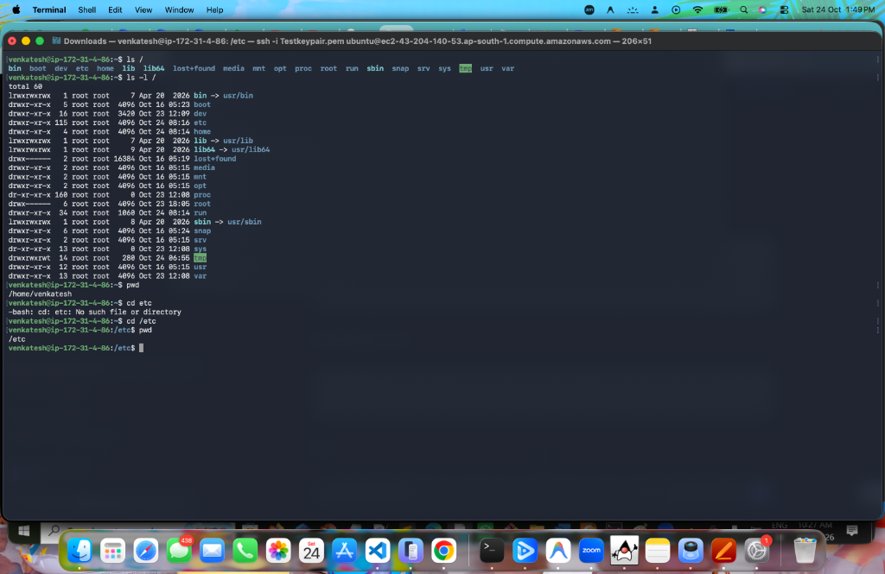
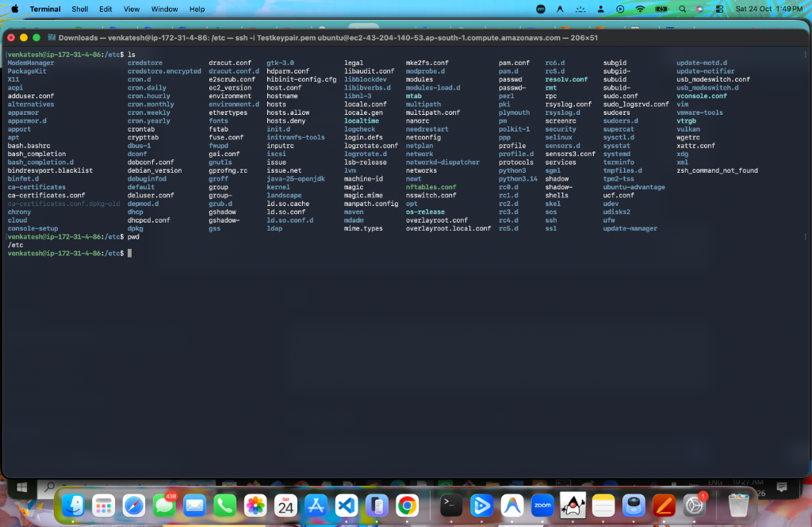
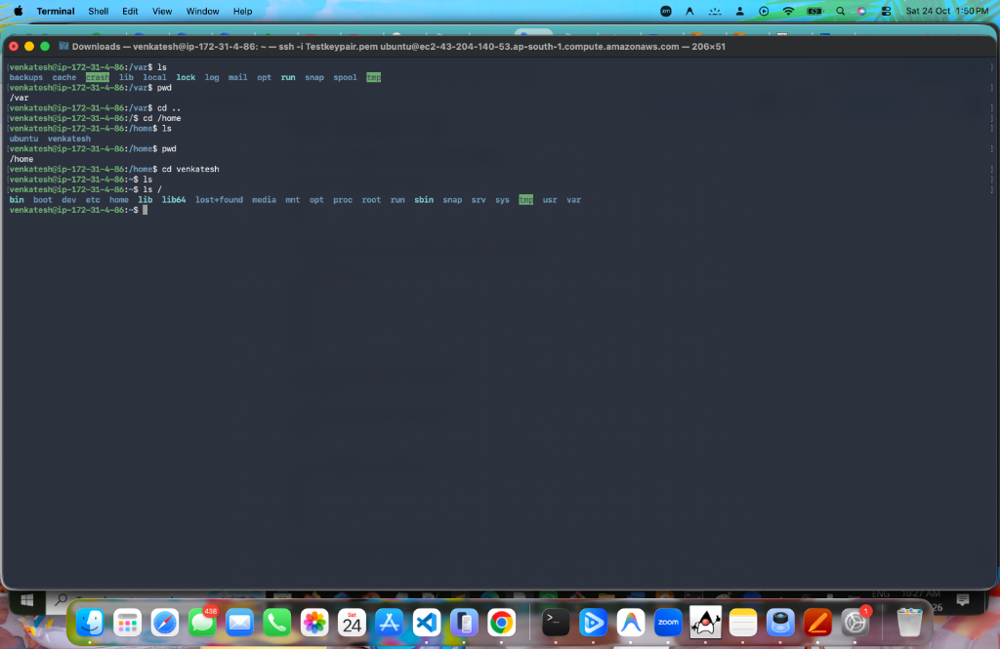
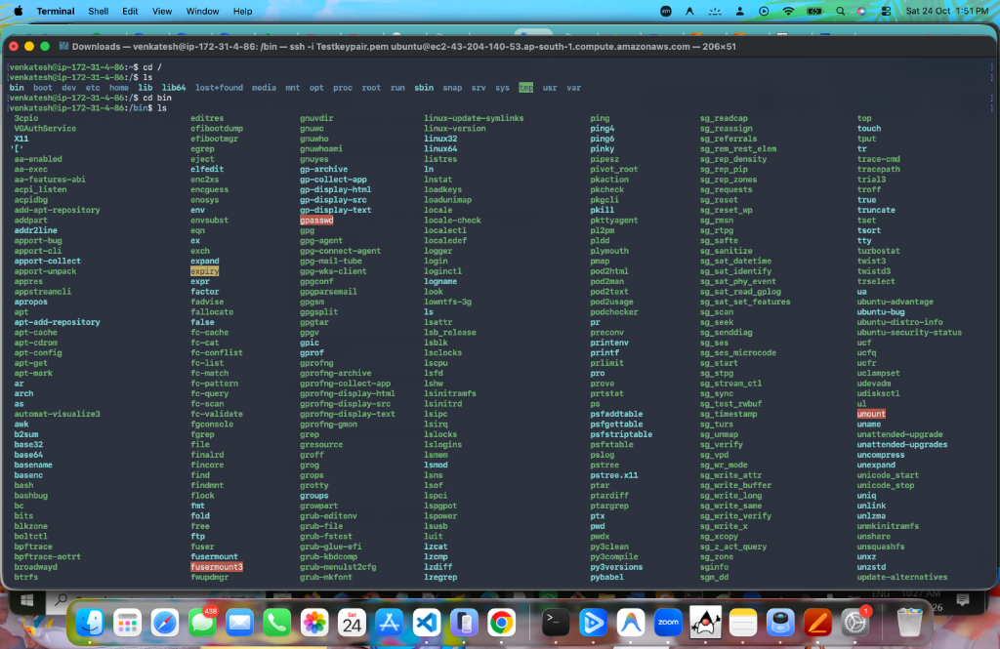
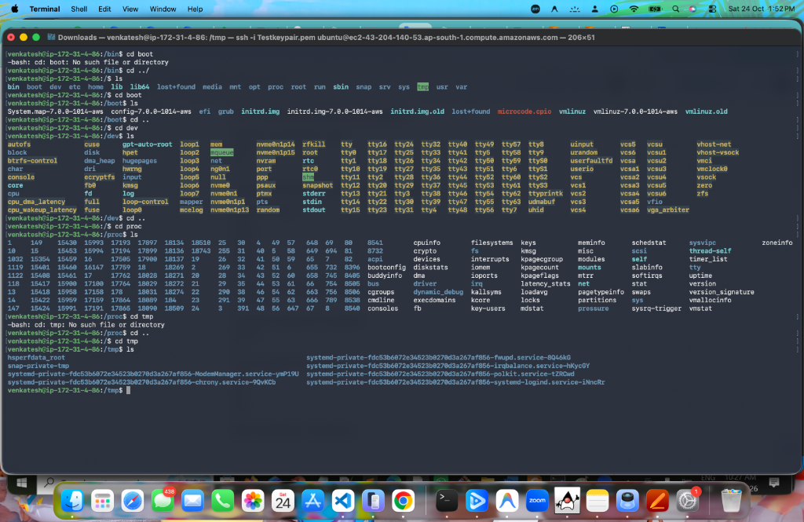
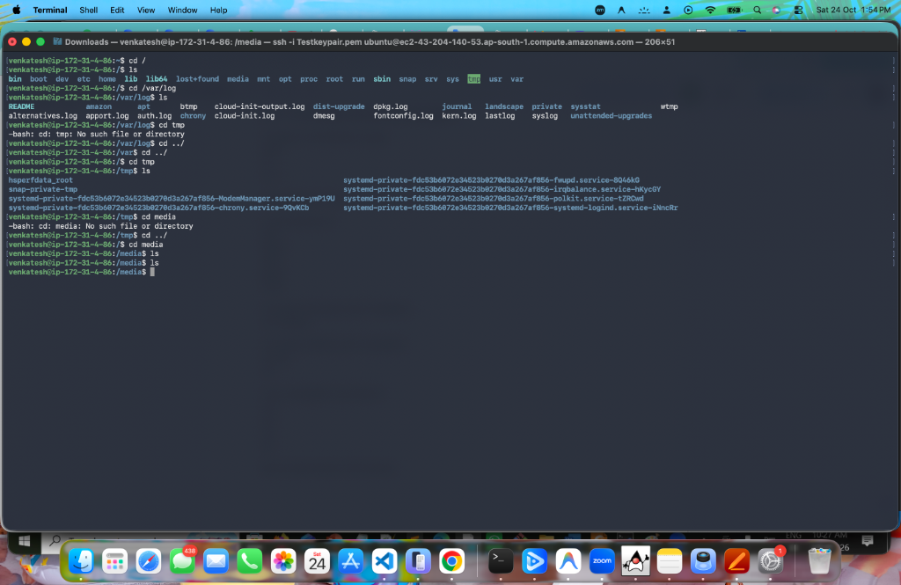
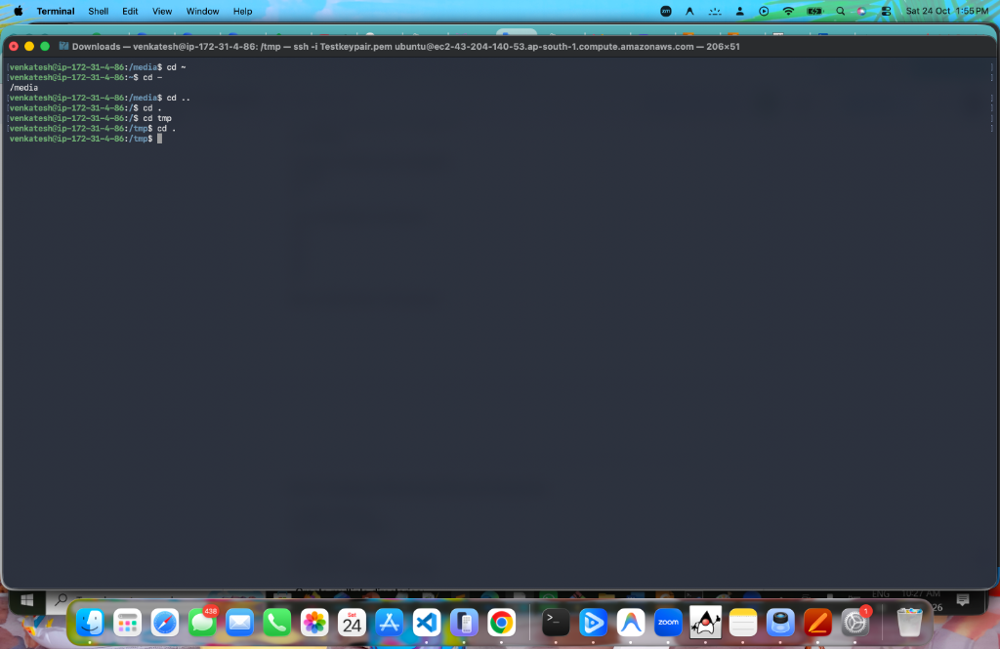
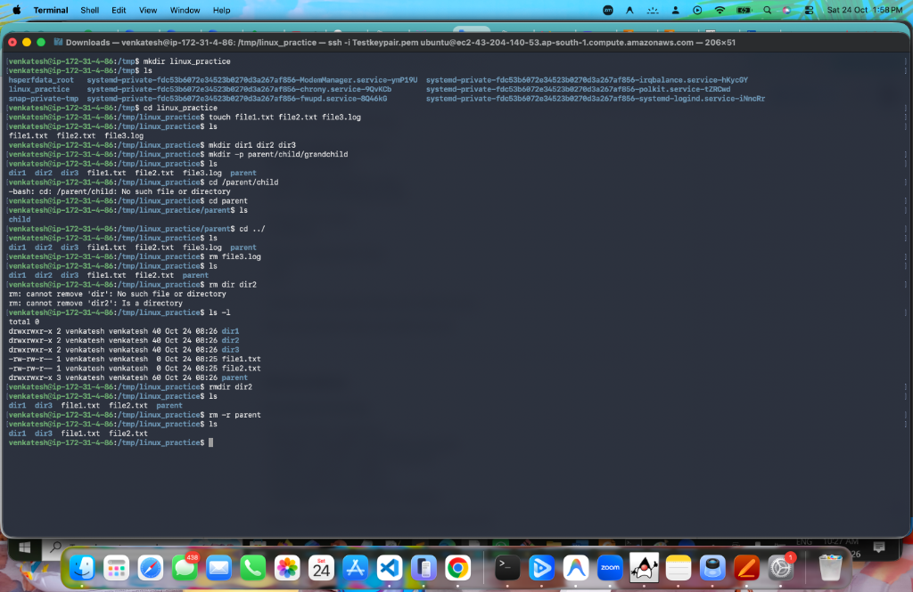

# Linux File System Structure & Navigation

> **Assignment:** File System Structure & Navigation  
> **Environment:** Ubuntu Linux 24.04 LTS (AWS EC2 Instance)  
> **Host / User:** `venkatesh@ip-172-31-4-86`  
> **Word Document:** [`FileSystemStructure_Assignment.docx`](file:///Users/venkatesh/Devops/LinuxAssignements/FileSystemStructure/FileSystemStructure_Assignment.docx)  
> **Submission Format:** Word Document (`.docx`) + GitHub Repository + Google Drive  

---

## 📌 Assignment Objective

The objective of this assignment is to:
1. Understand the Linux File System Hierarchy Standard (FHS).
2. Master directory navigation using absolute and relative paths.
3. Learn and practice essential file and directory creation and deletion operations (`mkdir`, `touch`, `rm`, `rmdir`).
4. Understand special path symbols and navigation operators (`.`, `..`, `~`, `-`).

---

## 📂 Linux Filesystem Hierarchy Standard (FHS) Overview

In Linux, all files and directories stem from the single root directory represented by a forward slash (`/`).

| Directory | Purpose / Description |
|---|---|
| `/` | **Root directory** — Top-level root of the entire file hierarchy. |
| `/bin` | **Essential User Binaries** — Common executable utilities (e.g., `ls`, `cp`, `rm`, `cat`). |
| `/boot` | **Bootloader Files** — Linux kernel (`vmlinuz`), initramfs, and GRUB config files. |
| `/dev` | **Device Nodes** — Special device files representing hardware and virtual devices (`/dev/sda`, `/dev/null`). |
| `/etc` | **Host Configuration** — System-wide configuration files and startup scripts (`/etc/passwd`, `/etc/network`). |
| `/home` | **User Home Directories** — Personal workspaces for standard users (e.g., `/home/venkatesh`). |
| `/lib` / `/lib64` | **Shared Libraries** — Critical kernel modules and shared libraries required by binaries in `/bin` and `/sbin`. |
| `/media` | **Removable Media** — Mount point for removable media devices (USB drives, CD-ROMs). |
| `/mnt` | **Temporary Mounts** — Mount point for temporarily mounted filesystems by sysadmins. |
| `/opt` | **Optional Software** — Add-on third-party software packages. |
| `/proc` | **Virtual Process Filesystem** — Kernel-generated runtime state, hardware info, and process stats. |
| `/root` | **Root Home** — Dedicated home directory for the superuser/root administrator. |
| `/run` | **Runtime Variable Data** — Information describing the system state since the last system boot. |
| `/sbin` | **System Binaries** — Administrative binaries reserved for the system admin (`reboot`, `fdisk`, `iptables`). |
| `/srv` | **Service Data** — Site-specific data served by network services (FTP, web). |
| `/sys` | **Kernel Hardware Subsystem** — Device tree and kernel subsystem export. |
| `/tmp` | **Temporary Files** — Volatile scratch space for applications; cleared on reboot. |
| `/usr` | **User Programs** — Secondary hierarchy containing user binaries, libraries, and documentation. |
| `/var` | **Variable Data** — Dynamic files that grow over time: logs (`/var/log`), caches, and spoolers. |

---

## 🛠️ Part 1: File System Structure & Navigation

### 1. Root Directory Exploration & `/etc` Navigation

**Commands Executed:**
```bash
pwd
ls /
ls -l /
cd etc
cd /etc
pwd
```

**Terminal Output Screenshot:**



**Key Observations:**
- Initial working directory verified using `pwd`: `/home/venkatesh`.
- The root directory (`/`) was listed using `ls /` and long listing `ls -l /`, displaying permissions, links, and system folders.
- Attempting `cd etc` returned `-bash: cd: etc: No such file or directory` because `etc` without a leading `/` is evaluated as a relative path inside `/home/venkatesh`.
- Specifying the absolute path `cd /etc` succeeded, verified by `pwd` outputting `/etc`.

---

### 2. Listing Contents of `/etc`

**Commands Executed:**
```bash
ls
pwd
```

**Terminal Output Screenshot:**



**Key Observations:**
- The `/etc` folder contains host-specific system configuration files, networking settings (`netplan`, `hosts`), cron job tables (`crontab`, `cron.daily`), and user database files (`passwd`, `group`, `shadow`).

---

### 3. Navigating into `/var` and `/home` & Verifying with `pwd`

**Commands Executed:**
```bash
cd /var
ls
pwd
cd ..
cd /home
ls
pwd
cd venkatesh
ls
ls /
```

**Terminal Output Screenshot:**



**Key Observations:**
- Navigated into `/var` (variable data such as logs and spoolers) and verified location using `pwd`.
- Stepped up one directory level to root via `cd ..` and then entered `/home`.
- Listed `/home` contents showing user directories: `ubuntu` and `venkatesh`.
- Successfully verified navigation into `/home/venkatesh` and listed user files.

---

### 4. Listing System Directory Contents: `/bin`

**Commands Executed:**
```bash
cd /
ls
cd bin
ls
```

**Terminal Output Screenshot:**



**Key Observations:**
- Navigated into `/bin` and listed all executable system commands (e.g., `bash`, `cat`, `chmod`, `cp`, `grep`, `ls`, `mkdir`, `rm`, `touch`).
- On modern Ubuntu Linux, `/bin` is symlinked to `/usr/bin`.

---

### 5. Listing Contents of `/boot`, `/dev`, `/proc`, and `/tmp`

**Commands Executed:**
```bash
# Attempt relative navigation from /bin (fails as boot is at /)
cd boot
# cd ../ to root
cd ../
ls
# Explore /boot
cd boot
ls
cd ..
# Explore /dev
cd dev
ls
cd ..
# Explore /proc
cd proc
ls
# Attempt relative navigation to tmp from /proc (fails)
cd tmp
cd ..
# Explore /tmp
cd tmp
ls
```

**Terminal Output Screenshot:**



**Key Observations:**
- `/boot`: Contains the Linux kernel (`vmlinuz-7.0.0-1014-aws`), initial RAM disk (`initrd.img`), system maps, and GRUB bootloader files.
- `/dev`: Contains hardware device nodes including loop devices (`loop0`), NVMe partitions (`nvme0n1p1`), memory devices (`null`, `zero`), and terminals (`tty`).
- `/proc`: Virtual filesystem generated on the fly by the Linux kernel containing live process IDs (`PID`) and hardware stats (`cpuinfo`, `meminfo`, `partitions`).
- `/tmp`: Contains temporary scratch files, runtime sockets, and systemd service directories.

---

### 6. Absolute vs. Relative Path Navigation

**Commands Executed:**
```bash
cd /var/log
ls
cd ../
cd ../
cd tmp
ls
cd ../
cd media
ls
```

**Terminal Output Screenshot:**



**Key Observations:**
- **Absolute Path:** `cd /var/log` navigated directly to the system log directory starting from the root directory.
- **Relative Path:** Used `cd ../` twice to traverse up from `/var/log` to `/var` and then to `/`.
- Demonstrated downward relative movement by switching directly into `tmp` and `media` from `/`.

---

### 7. Directory Navigation Shortcuts (`~`, `-`, `..`, `.`)

**Commands Executed:**
```bash
cd ~
cd -
cd ..
cd .
cd tmp
cd .
```

**Terminal Output Screenshot:**



| Shortcut | Action in Session | Current Directory |
|---|---|---|
| `cd ~` | Navigated directly to user's home directory | `/home/venkatesh` |
| `cd -` | Toggled back to the previous directory | `/media` |
| `cd ..` | Moved one directory level upward to parent | `/` |
| `cd .` | Stayed in current directory | `/` |
| `cd tmp` | Relative traversal into `/tmp` | `/tmp` |
| `cd .` | Maintained current working directory | `/tmp` |

---

## 🛠️ Part 2: Creating & Removing Files and Directories

### 1. File and Directory Creation & Removal Operations

**Commands Executed inside `/tmp`:**
```bash
# 1. Create main practice directory
mkdir linux_practice
ls

# 2. Navigate inside
cd linux_practice

# 3. Create multiple files simultaneously
touch file1.txt file2.txt file3.log
ls

# 4. Create multiple directories simultaneously
mkdir dir1 dir2 dir3

# 5. Create nested directories in a single command using -p
mkdir -p parent/child/grandchild
ls

# 6. Verify nested directory structure
cd parent
ls
cd ../

# 7. Remove single file
rm file3.log
ls

# 8. Attempt removing directory with plain rm (demonstrating expected error)
rm dir dir2
# rm: cannot remove 'dir': No such file or directory
# rm: cannot remove 'dir2': Is a directory

# 9. List directory details
ls -l

# 10. Remove empty directory
rmdir dir2
ls

# 11. Remove non-empty nested directory recursively
rm -r parent
ls
```

**Terminal Output Screenshot:**



---

### 2. Practice Directory Hierarchy Tree

```text
linux_practice/
├── dir1/
├── dir2/
├── dir3/
├── file1.txt
├── file2.txt
├── file3.log
└── parent/
    └── child/
        └── grandchild/
```

---

### 3. Key Differences: `rm`, `rmdir`, and `rm -r`

> [!IMPORTANT]
> 1. `rm <file>`: Removes regular files (e.g., `rm file3.log`). Attempting `rm dir2` throws `rm: cannot remove 'dir2': Is a directory`.
> 2. `rmdir <dir>`: Removes **only empty** directories (e.g., `rmdir dir2`). Fails if the directory contains any files or subdirectories.
> 3. `rm -r <dir>`: **Recursively** removes the directory and all of its nested contents (e.g., `rm -r parent`).

---


